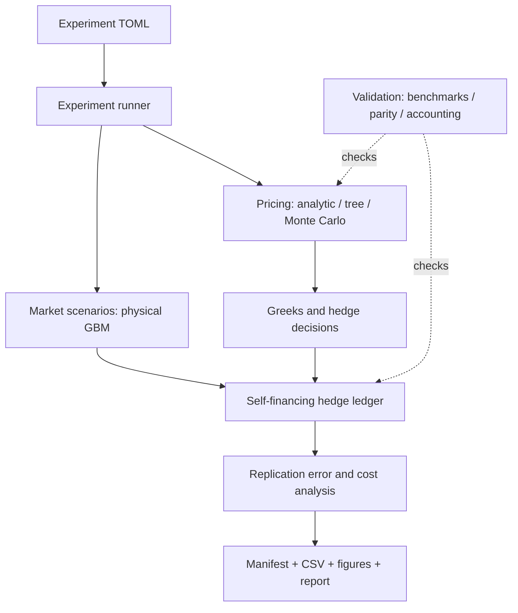

# Option Pricing & Delta Hedging Lab

An educational financial engineering research project: pricing European options,
comparing numerical methods, and studying the trade-off between hedge error and trading costs.

**Status: all six original milestones are complete, including the final research report and worked demonstration.**
Monte Carlo is the computational centerpiece: three estimators, repeated-seed uncertainty,
vectorization and memory/throughput benchmarks. The one-path hedge example now
connects prices to cash/trades/costs and settlement. The paired study measures
frequency/cost/model-sigma effects over10,000 common paths. The final 12-page report
and a second contract-review example show how to use the existing interfaces.
Findings are conditional model results, not real-market performance.

Read the [final research report](output/pdf/option_pricing_hedging_research_report.pdf),
[editable report](reports/final/research_report.md),
[Thai worked application](docs/USE_CASE_TH.md) and
[five-minute demonstration script](docs/DEMO_SCRIPT_TH.md).
This remains an option-pricing/hedge research project, separate from stock selection
and multi-asset portfolio allocation. Market quotes and implied-volatility inversion
are potential subsequent extensions, not current capabilities.

[Current quality assessment in Thai](docs/PROJECT_AUDIT_TH.md) explains the value of
each stage, measured limitations and remaining work. Completed-stage validation now
also includes 144 option scenarios, an independent payoff integral and 13,824 MC
stress estimates, with recoverable source snapshots for new runs.

Start with [the Thai architecture guide](docs/ARCHITECTURE_TH.md), then
[the research specification](docs/RESEARCH_SPEC.md) and [the learning roadmap](docs/ROADMAP_TH.md).

## V2-A: Asian options and five-method Monte Carlo

The path-dependent pricing extension is implemented and executed: 2,880 estimates,
18,432 raw scramble prices, five methods, explicit work counts, optional pinned
QuantLib comparisons and a custom-contract CLI. See the
[Thai guide and measured limitations](docs/ASIAN_MONTE_CARLO_TH.md),
[executed research](reports/examples/v2-asian/RESULTS.md) and
[independent numerical audit](reports/verification/v2-asian-checks.json).
The final strict suite passes 529 tests; independent review findings were fixed
with reproducing regressions, and nine numerical/input artifacts replay byte-identically.
All six primary external references missed the predeclared precision target;
precision-dependent rankings are withheld for all 90 cells. Sampling-dispersion,
timing and allocation evidence remains reported. This is a research component,
not live-market validation or production certification.

```sh
export PYTHONPATH="$PWD/src"
.venv/bin/python -m pip install -r requirements-research.txt  # optional reference engines
.venv/bin/python -m option_hedging.experiments.asian_study --config configs/asian_custom.toml --output-dir reports/runs/my-asian-run
```

Requires SciPy >=1.15 for Sobol's Generator API. Existing v1 outputs are historical
and unchanged. Run the full strict suite with `.venv/bin/python -m pytest -q -W error`.

## Research question

How do hedge frequency, transaction costs and volatility misspecification affect
the terminal replication error of a short European call?

## Scope

- One simulated underlying; European call and put pricing.
- Black-Scholes analytic baseline, CRR binomial tree and Monte Carlo pricing.
- Delta and gamma/vega diagnostics; a self-financing delta hedge for a short call.
- Daily versus weekly hedging; costs and volatility misspecification.
- Reproducible model-based experiments and an English research report.

Historical option backtesting, live trading, American options, a web UI, ML and
multi-asset optimization are outside the first version.

## Architecture



See [interfaces and dependencies](docs/INTERFACES.md) for the planned contracts.
`contracts.py`, `pricing/black_scholes.py`, `pricing/binomial.py`,
`experiments/pricing_demo.py`, `experiments/convergence_demo.py`, `pricing/monte_carlo.py`
and `experiments/monte_carlo_demo.py` are implemented. `simulation/gbm.py` provides
exact terminal and full-path sampling. `simulation/time_grid.py` and
`experiments/paths_demo.py` provide exact-expiry grids and reusable physical paths.
`hedging/ledger.py` and `experiments/hedge_demo.py` implement the one-path ledger
and unhedged baseline. `experiments/runner.py` now executes the paired physical-GBM study.

## Local setup

Use Python 3.11 or newer. From this folder:

```sh
python3 -m venv .venv
source .venv/bin/activate
export PYTHONPATH="$PWD/src"
python -m pip install -e '.[dev]'
python -c "import option_hedging; print(option_hedging.__version__)"
```

Installation and tests have been executed in the project's local `.venv`.
`requirements-lock.txt` records tested dependency versions on Python 3.13/macOS;
it is an environment snapshot, not a hash-verified or cross-platform lock.

## Run milestone 1

```sh
source .venv/bin/activate
export PYTHONPATH="$PWD/src"
python -m pytest -q
python -m option_hedging.experiments.pricing_demo
```

The demo reads only `[option]` from `configs/baseline.toml` and creates a new UTC-named
folder in `reports/runs/`. It writes baseline prices/Greeks, sensitivity CSVs,
`pricing_and_greeks.png`, the exact input config and a source/environment manifest.
Choose a destination with `--output-dir reports/runs/my-demo`; it must not exist.
No hedge scenario is run by this pricing demo.

Baseline: S=100, K=100, r=5%, volatility=20%, T=1 year, no dividends.
Call price = 10.4505835722; put price = 5.5735260223.

Read [the Thai learning guide](docs/LEARNING_GUIDE_TH.md) alongside the code.
Validation evidence and remaining scope: [progress record](docs/PROGRESS.md).
An executed example is included in `reports/examples/milestone-1/`.

## Run milestone 2A: CRR convergence

```sh
source .venv/bin/activate
export PYTHONPATH="$PWD/src"
python -m option_hedging.experiments.convergence_demo
```

The demo consumes `[option]` and `[convergence].steps` in `configs/baseline.toml`.
It calculates call/put prices over the explicit odd/even grid, compares Black-Scholes,
and records signed/absolute errors and illustrative elapsed times. `[pricing].tree_steps`
is reserved for the future full experiment runner; it does not select this grid.
The CLI writes `convergence.csv`, `summary.json`, `convergence.png`, the exact input and
a source/environment manifest to a new folder. Existing output directories are refused.
Read [the Thai numerical-pricing guide](docs/NUMERICAL_PRICING_TH.md).
An executed final example is included in `reports/examples/milestone-2a/`.

Older example manifests record the source/configuration at their own creation time.
They are historical records; they are not expected to match every later code revision.

## Run milestone 2B: Monte Carlo research lab

```sh
PYTHONPATH=src .venv/bin/python -m option_hedging.experiments.monte_carlo_demo
```

Uses the dedicated `configs/monte_carlo.toml`. Plain MC, antithetic pair means and
an independent-pilot discounted-stock control variate are tested across five sample
sizes, three strikes, call/put and 64 independent repeats: 5,760 estimates.
Reports include RMSE bootstrap intervals, CI coverage with Wilson intervals,
work-normalized gains and repeated CPU benchmarks. Exact terminal GBM and batched
central-moment accumulation give O(N) time and O(batch size) workspace.

See [the Thai Monte Carlo/Computer Engineering guide](docs/MONTE_CARLO_TH.md),
and [the executed research results](reports/examples/milestone-2b/RESULTS.md).
The example includes raw data, four figures, exact inputs and source/artifact hashes.
Kernel speedup excludes RNG and uncertainty; it is distinct from complete estimator
performance. Normal CIs are approximate and zero observed variance does not prove
an exact price. This experiment does not run a hedge.

## Run milestone 3: full GBM paths

```sh
PYTHONPATH=src .venv/bin/python -m option_hedging.experiments.paths_demo
```

Uses `configs/gbm_paths.toml`: 10,000 physical paths over 252 intervals, paired RN
diagnostics on identical Brownian shocks, and 32 independent validation repeats.
Exact transitions support irregular times and deterministic limits. Batched draws
use O(batch size * intervals) workspace; the returned full matrix itself needs
O(paths * time points) storage. Save `paths.npy`/`times.npy` for future hedge comparisons.

Read [the Thai GBM guide](docs/GBM_PATHS_TH.md) and
[the executed path results](reports/examples/milestone-3/RESULTS.md).
The percentile fan shows dispersion across simulated paths; mean CIs are separate.
Physical drift and volatility are explicit scenario assumptions, not market estimates.
The self-financing hedge ledger is implemented; its explicit-path example follows below.

## Repository map

```text
configs/baseline.toml       Baseline assumptions and planned sensitivity grid
configs/monte_carlo.toml    Executable MC accuracy and engineering experiment
configs/gbm_paths.toml      Full physical paths and paired RN diagnostics
src/option_hedging/
  contracts.py             Validated OptionSpec and Greeks records
  pricing/                 Analytic, tree and Monte Carlo pricing
  simulation/              Explicit physical/risk-neutral GBM paths
  hedging/                 Implemented short-call cash/trade/cost/settlement ledger
  validation/              Independent payoff integral with bounded omitted tails
  analysis/                Pricing/path/uncertainty summaries and figures; paired hedge metrics implemented
  experiments/             Pricing/path/validation demos and provenance; paired hedge runner implemented
tests/                     Validation cases specified before implementation
docs/                      Architecture, interfaces, scope and learning roadmap
notebooks/                 Learning and exploration; no duplicated core formulas
data/                      Policy for simulated and future external inputs
reports/                   Verified run outputs, final report sources and evidence
output/pdf/                Completed English research report
```

The repository is a preparation and learning artifact, not an official NUS assignment
or an assurance of admission. The aim is to explain every assumption and result.

## Validate completed stages across regimes

```sh
PYTHONPATH=src .venv/bin/python -m option_hedging.experiments.validation_demo
PYTHONPATH=src .venv/bin/python -m option_hedging.experiments.verify_run reports/examples/research-validation
```

Uses `configs/validation.toml`: 144 call/put scenarios spanning maturity, volatility,
strike and negative/positive rates; 432 CRR rows; 13,824 repeated MC estimates.
Analytic prices are checked against a separate direct payoff integral with an
explicit omitted-tail bound. Raw normal-CI failures and zero sample SEs are retained.
See [executed results](reports/examples/research-validation/RESULTS.md).

New runs of all seven demos/experiments include `source_snapshot.zip`, actual source/config bytes,
recorded dependencies and replay instructions. Earlier examples remain historical
hash-only records. [Integrity and replay instructions](docs/REPRODUCIBILITY.md) distinguish
checking saved bytes from executing recovered code and from financial validation.

## Run milestone 4: self-financing short-call ledger

```sh
PYTHONPATH=src .venv/bin/python -m option_hedging.experiments.hedge_demo
```

Uses configs/hedge_ledger.toml with one explicit illustrative stock path. Receive
the model premium, buy/sell delta shares, accrue cash at the actual interval rate,
charge all stock costs and close/pay the call at expiry. Frozen per-event records
include cash flows and positions; an unhedged same-premium baseline and zero-cost
counterfactual make financing/cost accounting inspectable. No RNG is used here.

Read [the Thai hedging/accounting guide](docs/HEDGING_TH.md) and
[executed example](reports/examples/milestone-4/RESULTS.md). Before expiry assets_value
excludes the short-option liability. A one-path profit comparison is not evidence
of aggregate hedge effectiveness. The paired Monte Carlo study is implemented below.

## Run milestone5: paired Monte Carlo hedge study

```sh
PYTHONPATH=src .venv/bin/python -m option_hedging.experiments.runner
```

Uses dedicated configs/hedge_study.toml:10,000 shared physical-GBM paths,18 hedge
policies plus3 unhedged cases,42 metric cells,102 paired contrasts and1,000 shared
path-ID bootstrap resamples. All210,000 case/path outcomes are saved. Model-premium
and common-premium results separate pricing receipts from hedge-policy effects.
Vectorized accounting is checked against the scalar ledger on16 fixed path IDs
per case; paths/raw results/bootstrap statistics/config/source are recoverable.
The date loop uses O(N) workspace; full-matrix validation currently uses O(NM)
boolean temporaries. Stage timings are observations, not a speedup or RSS benchmark.

Read [measured findings in Thai](docs/HEDGE_STUDY_TH.md) and
[the complete executed study](reports/examples/milestone-5/RESULTS.md).
[Practical-use assessment](docs/PRACTICAL_USE_TH.md) distinguishes company research
use from production/live trading and the user's long-stock/ETF protection goal.
The present hedge engine handles one short European call; it does not recommend
long/short options or estimate drawdown protection for a multiasset portfolio.
