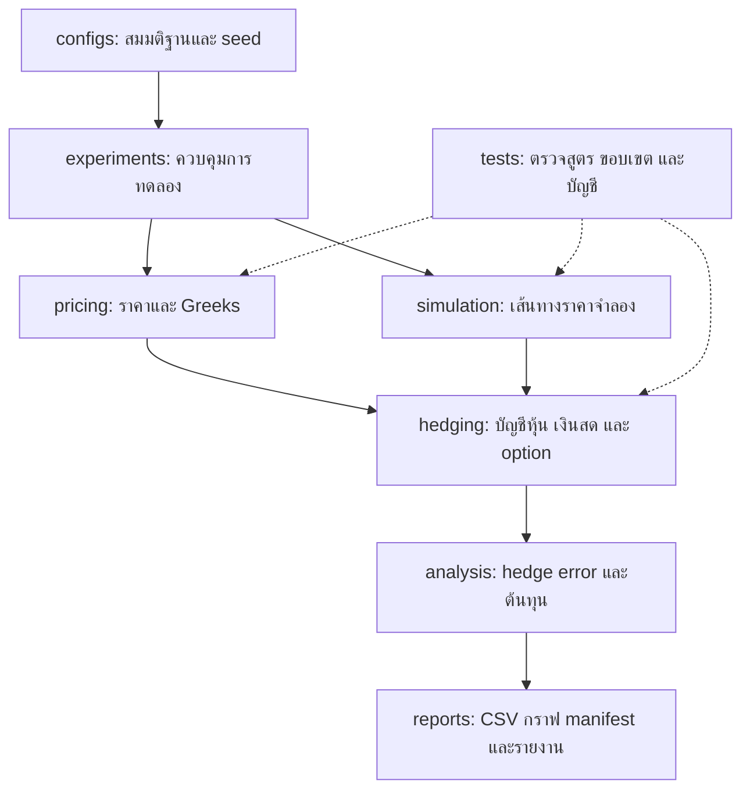

# Architecture: Option Pricing & Delta Hedging Lab

เป้าหมายคือมีผลงานที่อธิบายคณิตศาสตร์ วิธีคำนวณ และผลการทดลองได้ด้วยตัวเอง
เพื่อเสริมความพร้อมสำหรับเรียน Financial Engineering ไม่มีการอ้างว่าเป็นเกณฑ์รับเข้าอย่างเป็นทางการ

สถานะปัจจุบัน: ทำ Black-Scholes call/put, Delta/Gamma/Vega และ pricing demo แล้ว
เพิ่ม CRR binomial pricing และ convergence demo แล้วด้วย
Monte Carlo ทำแล้วทั้ง plain/antithetic/control พร้อม exact terminal GBM และ CPU benchmarks
simulation แบบหลายเวลาทำแล้ว พร้อมกริดวันหมดอายุและเส้นทางเต็มสำหรับใช้ร่วมกัน
ทำ self-financing hedge ledger และตัวอย่างบัญชีหนึ่งเส้นทางแล้ว
paired hedge experimentsทำแล้วบน10,000เส้นทาง และรายงาน v1 เสร็จแล้ว
ส่วนขยาย V2-A Asian Monte Carlo ทำแล้ว โดยรายงานข้อจำกัด reference precision ไว้ชัดเจน

## ภาพรวม

## หน้าที่ของแต่ละส่วน

| ส่วน | หน้าที่ | สิ่งที่ต้องระวัง |
|---|---|---|
| contracts | กำหนดข้อมูลเข้าออกและหน่วย | เวลาเป็นปี, rate/volatility เป็นรายปี, option kind ต้องถูกต้อง |
| pricing | Black-Scholes, CRR tree, Monte Carlo และ Greeks | ใช้ risk-neutral pricing; ไม่ใช้ผลตอบแทนคาดหวังจริงแทน risk-free rate |
| simulation | สร้างเส้นทาง GBM พร้อม measure และ seed | แยก physical drift สำหรับการทดลอง hedge จาก risk-neutral drift สำหรับ pricing |
| hedging | คำนวณ delta ซื้อขายหุ้น ดอกเบี้ยเงินสด ต้นทุน และ payoff | ห้ามเติมเงินภายหลังโดยไม่บันทึก; ห้ามใช้ราคาอนาคตตัดสินใจ |
| analysis | เปรียบเทียบการกระจาย terminal P&L, RMSE, quantile และต้นทุน | กำไรเฉลี่ยอย่างเดียวไม่แสดงความเสี่ยงทั้งหมด |
| experiments | อ่าน config เรียกส่วนต่าง ๆ และบันทึกผล | ทุกชุดเปรียบเทียบใช้เส้นทางราคาเดียวกันเพื่อลด noise |
| reports | เก็บผลพร้อมสมมติฐานและรายงาน | ระบุว่าเป็น simulation และเผยแพร่ผลที่ไม่สนับสนุนสมมติฐานด้วย |

## ตัวอย่างการไหลของหนึ่งการทดลอง

1. อ่านค่า S=100, K=100, r=5%, sigma=20%, อายุหนึ่งปี จาก baseline.toml
2. คำนวณ premium ของ call ภายใต้ Black-Scholes
3. จำลองราคาหุ้นภายใต้ physical measure โดยระบุ drift และ true volatility
4. จำลองผู้ขาย call ที่รับ premium แล้วซื้อหุ้น delta หน่วยด้วยเงินสดและการกู้ยืม
5. ปรับหุ้นตามตาราง hedge โดยใช้ข้อมูลถึงเวลานั้นเท่านั้น และหักต้นทุนทุกครั้ง
6. ตอนหมดอายุจ่าย payoff ขายหุ้นคงเหลือ และสรุปเงินสดสุทธิ
7. ทำซ้ำหลายเส้นทาง เปรียบเทียบ hedge ทุก 1 กับ 5 trading steps
8. บันทึก config, environment, seed, metrics, ledger ตัวอย่าง และกราฟ

การปรับทุก 5 steps เป็นแบบจำลอง weekly บนกริด 252 วัน ไม่ใช่ปฏิทินตลาดจริง

## ขอบเขตเวอร์ชันแรก

- สินทรัพย์จำลองหนึ่งตัว ไม่มีเงินปันผล อัตราดอกเบี้ยคงที่ และ GBM volatility คงที่ต่อ scenario
- ราคา European call/put; งาน hedge เริ่มที่ short call จำนวนหนึ่งสัญญาจำลอง multiplier=1
- เปรียบเทียบ analytic/tree/Monte Carlo แล้วศึกษาความถี่ hedge ต้นทุน และ volatility ที่ประมาณผิด
- ใช้ Python + NumPy + SciPy + pandas + Matplotlib + pytest
- เริ่มจากรายงานและกราฟ; dashboard และข้อมูล option จริงเป็นการต่อยอดหลังวิธีคำนวณถูกต้อง

## Dependencies ภายใน

contracts เป็นฐาน; analytic/tree pricing ไม่เรียก simulation ส่วน Monte Carlo ใช้ตัวสร้าง GBM ร่วมกันได้;
simulation ไม่เรียก pricing; hedging ใช้ contracts และ pricing;
analysis อ่านผล pricing/simulation/hedge; experiments ประกอบทุกส่วนเข้าด้วยกัน
ส่วน pricing/simulation/hedging ไม่เขียนไฟล์และไม่อ่าน config เอง เพื่อให้ทดสอบได้แยกกัน

## เริ่มพัฒนาที่ไหน

ขั้นแรกทำแล้วใน contracts.py และ pricing/black_scholes.py พร้อม tests/test_black_scholes.py
และ tests/test_greeks.py ตรวจค่า baseline, parity, Greeks และกรณีหมดอายุ/volatility ศูนย์
รันตัวอย่างด้วย python -m option_hedging.experiments.pricing_demo หลังเปิด environment
CRR binomial tree และ convergence ทำแล้ว อ่าน NUMERICAL_PRICING_TH.md เพื่อศึกษา
Monte Carlo ทำแล้ว อ่าน MONTE_CARLO_TH.md เพื่อเชื่อมสถิติกับ Computer Engineering
GBM หลายเวลาทำแล้ว อ่าน GBM_PATHS_TH.md; ledger ทำแล้ว อ่าน HEDGING_TH.md
paired hedge experimentsทำแล้ว อ่าน HEDGE_STUDY_TH.md และ PRACTICAL_USE_TH.md

รายงานอังกฤษ12หน้าทำแล้วที่ output/pdf/option_pricing_hedging_research_report.pdf
ตัวอย่างสัญญาใหม่ใช้interfacesเดิมผ่านconfigs/contract_review_*.toml
ดู USE_CASE_TH.md และ DEMO_SCRIPT_TH.md การสร้างรายงานอยู่ใน reports/final/
แยกจากpricing/hedging core; ไม่เพิ่มportfolio allocationหรือmarket-data engine

## ส่วนขยาย Asian MC/RQMC ที่ทำแล้ว

asian_contracts → pure Brownian transforms / payoff kernel → pseudo-MC หรือ independent
Sobol scrambles → reference-aware analysis → asian_study CLI และ source manifest
validation/asian_reference ใช้ quadrature แยกจาก pricing kernel;
validation/asian_quantlib โหลด optional comparator แบบ lazy และคืน global evaluation date
existing OptionSpec/PriceEstimate และ hedge interfaces ไม่ถูกเปลี่ยน
อ่าน ASIAN_MONTE_CARLO_TH.md สำหรับแผนภาพความคิด ผลที่วัดและขอบเขตใช้งาน
