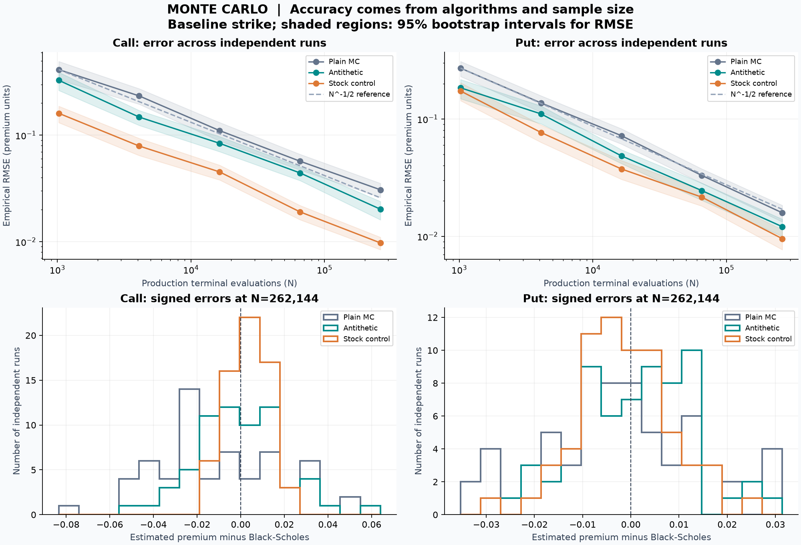
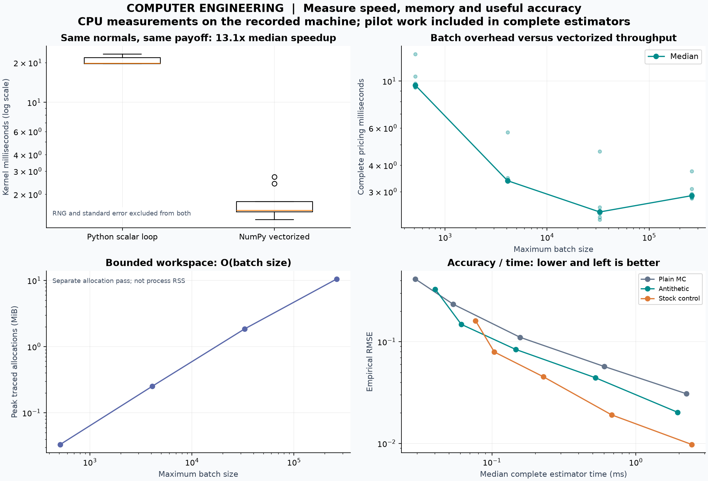
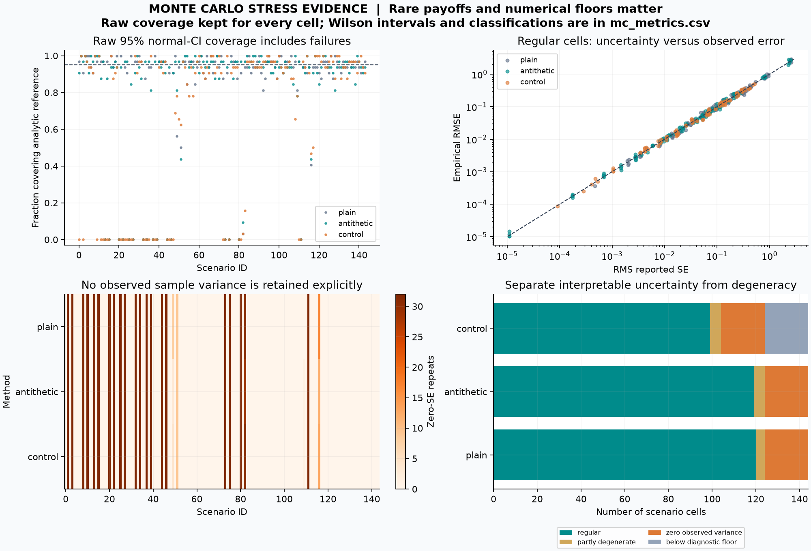
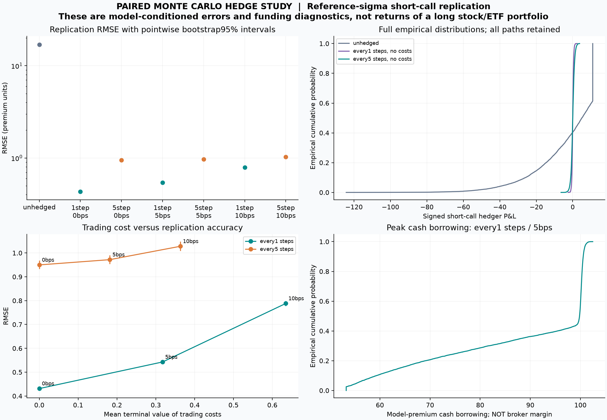
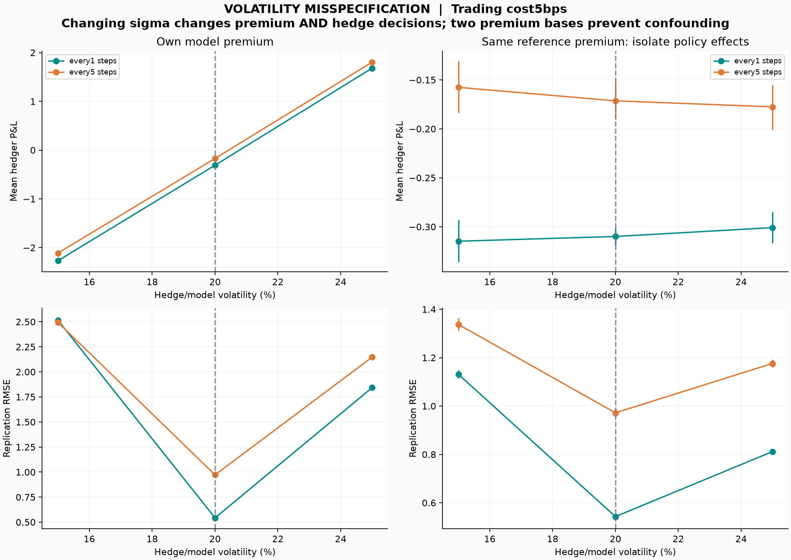

01 / RESEARCH REPORT

# Option Pricing & Delta Hedging

Monte Carlo accuracy, computational efficiency and auditable hedge risk

Completed research version | 23 October 2026 | Financial Engineering + Computer Engineering

### Abstract

This project builds and verifies a European option-pricing and short-call replication engine. Its main computational study compares plain Monte Carlo, antithetic pairs and an independent-pilot stock control variate. A paired simulation then measures how hedge frequency, transaction costs and volatility assumptions affect terminal cash P&L. All results are conditional experiments under a declared model; no market return or executable trading edge is inferred.

### Observed findings

At 262,144 production evaluations, baseline call RMSE falls from 0.03075 for plain MC to 0.00975 for the control estimator. Independent pilot work is counted. Empirical RMSE slopes across sample sizes are close to the expected -0.5 rate, while rare-payoff stress tests expose misleading zero sample errors.

At reference volatility 20% and 5 bps trading cost, hedging every grid step has RMSE 0.54279, versus 0.97187 every five steps. It also incurs more financed costs: 0.31736 versus 0.18155. A model-sigma change can alter the premium received; fixing that premium removes an apparent profit in the high-sigma example.

| Evidence | Retained scope |
| --- | --- |
| Pricing research | 5,760 repeated MC estimates; 144 independent-reference scenarios |
| Hedge research | 10,000 common paths; 21 cases; 210,000 path outcomes |
| Verification | 390 tests passed; scalar/vector checks and source replay evidence |
| Practical demonstration | Second six-month contract; prices, Greeks and 63,000 hedge outcomes |

Research question: how do discrete trading, costs and volatility misspecification change short-call replication error, and how much computation is needed to estimate those effects reliably?

02 / RESEARCH REPORT

## Model, units and self-financing accounting

One non-dividend-paying underlying follows geometric Brownian motion (GBM). The primary study fixes S0=K=100, T=1 year, continuously compounded r=5%, assumed physical drift mu=8% and true scenario volatility sigma=20%. None is estimated from market data. A European call is sold with unit multiplier; fractional shares and unlimited borrowing/lending at r are allowed.

### Pricing measure versus scenario measure

```text
S(t+dt) = S(t) exp((drift - sigma^2/2)dt + sigma sqrt(dt) Z)
Z ~ N(0,1) independently across paths/increments
Pricing: drift = r;  call value = E_Q[exp(-rT) max(S_T-K,0)]
Hedge scenarios: drift = mu; mu is not a forecast from this project
```

Exact GBM transitions remove Euler time-discretization error in this model. They do not remove the error from trading only at discrete dates. European pricing needs only terminal samples; hedge accounting requires prices throughout the path.

### Analytic and tree pricing references

```text
d1 = (log(S/K) + (r + sigma^2/2)*T) / (sigma*sqrt(T))
d2 = d1 - sigma*sqrt(T); Phi = standard-normal CDF
Call = S*Phi(d1) - K*exp(-r*T)*Phi(d2)
Put = K*exp(-r*T)*Phi(-d2) - S*Phi(-d1)
CRR: u=exp(sigma*sqrt(dt)); d=1/u
p=(exp(r*dt)-d)/(u-d); discount one-step expected payoffs
```

CRR rejects invalid transition probabilities rather than clipping them. Expiry and zero-volatility cases are handled separately; analytic Greeks at derivative kinks are explicitly undefined. The formulas here apply to positive maturity/volatility.

### Cash ledger and event order

```text
Opening: receive C0; buy delta0 shares
B0 = C0 - delta0*S0 - opening_cost
Each date: B_pre = B_previous * exp(r*dt)
Rebalance before expiry:
B_new = B_pre - (delta_new-delta_old)*S - trade_cost
Expiry: P&L = B_pre + delta_old*S_T - close_cost - call_payoff
```

Delta uses only the current spot and time remaining. At expiry the held shares are liquidated and the payoff is paid; there is no new delta trade. One-way cost equals bps/10,000 times absolute traded shares times spot. Opening, rebalancing and liquidation costs all enter cash; financed costs must not be deducted a second time.

| Output | Interpretation |
| --- | --- |
| Price / terminal P&L | Currency units per one option unit, not portfolio return percentages |
| Delta / gamma | First / second local sensitivity to spot |
| Vega | Per 1.0 absolute volatility; divide by 100 for one percentage point |
| RMSE | sqrt(mean(P&L^2)); measures error around zero, including bias |
| Cash borrowing | Simulated cash deficit; not broker margin or investable capital |

03 / RESEARCH REPORT

## Monte Carlo: estimator and uncertainty design

The estimator never calls the analytic option price. Black-Scholes supplies the experiment's numerical reference. Independent streams are derived with SeedSequence identifiers and PCG64; raw run keys and estimates are saved. The lab spans five production sample sizes (1,024 to 262,144), three strikes (80, 100, 120), both payoff types, three methods and 64 independent repeats per cell.

| Method | Estimator | Independent observations / extra work |
| --- | --- | --- |
| Plain | Mean of discounted payoffs Y | N independent terminal evaluations |
| Antithetic | Mean of (Y(Z)+Y(-Z))/2 | N/2 independent pairs; N payoff evaluations |
| Control | Mean of Y-beta*(X-S0), X=exp(-rT)*S_T | N production observations + 2,048 independent pilot observations |

The control expectation E_Q[X]=S0 is known under the model. Beta is fitted on the pilot and frozen before production sampling. The estimator does not use the true option premium to tune its answer. Pilot draws are disjoint from production draws and their cost is included in work and timing comparisons.

```text
SE = sample_std(independent observations, ddof=1) / sqrt(n_independent)
Approximate 95% interval = estimate +/- 1.95996398454 * SE
Empirical RMSE = sqrt(mean((estimate - reference)^2))
```

### What the repeated experiment measures

Across independent repeats, the lab records signed bias, empirical standard deviation, RMSE and approximate-CI coverage. RMSE intervals use 2,000 bootstrap resamples of repeats; coverage proportions have Wilson intervals. These distinguish uncertainty in an individual price estimate from uncertainty in the measured performance of an estimator.

The asymptotic sampling reference is RMSE proportional to N^(-1/2): roughly four times the work is needed to halve sampling error without a better estimator. A better algorithm can improve accuracy per evaluation, but the benefit depends on payoff shape. Every strike/payoff result is retained, rather than selecting the best case.

### Numerical decisions

Batch-centered moments avoid subtracting nearly equal raw second moments. Sample values are normalized to spot units; underflow/overflow and unrepresentable moments produce explicit errors. Adjusted control prices and confidence intervals are not clipped to theoretical bounds. A zero observed variance is recorded, never treated as proof of an exact price.

04 / RESEARCH REPORT

## Monte Carlo: measured accuracy and calibration

Baseline S=K=100, T=1, r=5%, sigma=20%; N=262,144 production evaluations and 64 independent repeats per row. Analytic call/put references are 10.4505835722 and 5.5735260223. The intervals below describe finite-repeat uncertainty in measured RMSE.

| Payoff / method | RMSE | 95% RMSE interval | CI coverage | Work gain |
| --- | --- | --- | --- | --- |
| call / plain | 0.03075 | [0.02609, 0.03536] | 96.9% | 1.00 |
| call / antithetic | 0.02021 | [0.01606, 0.02390] | 95.3% | 2.32 |
| call / control | 0.00975 | [0.00842, 0.01101] | 100.0% | 9.87 |
| put / plain | 0.01585 | [0.01327, 0.01836] | 96.9% | 1.00 |
| put / antithetic | 0.01207 | [0.00999, 0.01398] | 93.8% | 1.73 |
| put / control | 0.00954 | [0.00768, 0.01139] | 96.9% | 2.74 |



Work gain is plain MSE divided by adjusted-method MSE, multiplied by plain work / adjusted work. Control pilot evaluations are included. For the baseline call its measured work-normalized gain is 9.87, not a guaranteed future speedup or an equal-wall-clock result.

Call log-log RMSE slopes are -0.477 (plain), -0.489 (antithetic) and -0.507 (control); put slopes are -0.513, -0.502 and -0.510. Coverage of 100% in 64 control-call repeats has a Wilson interval of about [94.3%, 100%], so it does not establish perfect calibration.

05 / RESEARCH REPORT

## Computer Engineering: speed, memory and boundaries

The engineering question is accuracy per computational resource. Terminal sampling and bounded batches avoid storing unnecessary full paths for European pricing. The implementation uses O(N + pilot) work and O(batch size) numerical workspace, with reproducible streams and explicit input/numerical validation.



| Batch size | Complete price median (ms) | Peak traced MiB |
| --- | --- | --- |
| 512 | 9.551 | 0.033 |
| 4,096 | 3.383 | 0.252 |
| 32,768 | 2.408 | 1.845 |
| 262,144 | 2.875 | 10.501 |

The identical-pre-generated-normal scalar/vector kernel benchmark has a median ratio of 13.06x over nine timed repeats after warm-up. RNG and standard-error calculation are excluded from both kernels; array allocation and validation are included. The scalar baseline is educational Python, not an optimized compiled competitor. This ratio is not end-to-end MC speedup.

Complete-estimator batching includes RNG, payoff and uncertainty calculation, while Generator construction is excluded for every call. Allocation is measured separately with tracemalloc, not process RSS. Timing and allocation ratios are local observations; scheduling, cache behavior, threading and library builds can change them. No GPU, multicore or cross-platform performance claim is made.

Hedge accounting instead keeps O(N*M) input paths, loops over dates and vectorizes over paths. Its date-loop workspace is O(N), but current input validation also creates O(N*M) temporary booleans. The whole hedge pipeline therefore has no claimed O(N) peak-memory bound.

06 / RESEARCH REPORT

## Validation: accurate arithmetic is not market accuracy

An independent discounted-payoff integral checks 144 scenarios across strike, tenor, volatility and rate, including both payoff types and negative rates. It does not call project pricing or GBM routines. Maximum analytic/integral absolute difference is 1.563e-13, below the declared 1e-7 tolerance. Quadrature error is estimated, with a separate normal-tail bound; relative accuracy for arbitrarily tiny premiums is not established.



| Method | Zero-SE repeats | Zero-SE with positive reference | Misses above floor |
| --- | --- | --- | --- |
| plain | 705 | 577 | 409 |
| antithetic | 694 | 566 | 415 |
| control | 698 | 570 | 574 |

The stress experiment retains 13,824 estimates (144 scenarios x 3 methods x 32 repeats, 8,192 production evaluations each). The display/interpretation floor is 1e-10; it does not repair or remove raw outcomes. A positive but rare payoff may never be sampled, giving price=0 and SE=0 even though the true premium is positive. These failures are part of the research finding.

Additional checks cover put-call parity, bounds, deterministic limits, finite-difference Greeks, invalid inputs and numerical range errors. CRR has absolute error 0.00175112 at 1,001 steps in the baseline; odd/even errors can oscillate. Physical/risk-neutral path diagnostics test model moments across independent repeats. None validates GBM against actual asset returns.

07 / RESEARCH REPORT

## Paired hedge study: design and reference results

The predeclared grid uses 10,000 independent physical GBM paths, 252 intervals, hedge frequencies of every 1/5 steps, costs of 0/5/10 bps, and model volatilities of 15/20/25%. There are 18 hedge cases plus three same-model-premium unhedged baselines. The same path IDs are used throughout; 1,000 shared whole-path bootstrap resamples preserve covariance in comparisons.

| Reference sigma=20% | Mean P&L | RMSE | 95% RMSE interval | Financed cost |
| --- | --- | --- | --- | --- |
| Unhedged | -2.00329 | 16.99733 | [16.60466, 17.40024] | 0.00000 |
| Every 1 / 0 bps | 0.00743 | 0.43122 | [0.42316, 0.43868] | 0.00000 |
| Every 5 / 0 bps | 0.01016 | 0.94984 | [0.93354, 0.96803] | 0.00000 |
| Every 1 / 5 bps | -0.30994 | 0.54279 | [0.53366, 0.55195] | 0.31736 |
| Every 5 / 5 bps | -0.17139 | 0.97187 | [0.95414, 0.99101] | 0.18155 |
| Every 1 / 10 bps | -0.62730 | 0.78820 | [0.77748, 0.79877] | 0.63473 |
| Every 5 / 10 bps | -0.35293 | 1.02792 | [1.00924, 1.04742] | 0.36310 |



At 5 bps, every-one minus every-five RMSE is -0.42908, with paired 95% interval [-0.44634, -0.41135]. This is evidence of lower replication RMSE under this model, alongside higher trading cost and a more negative mean. The finer policy also remains lower-RMSE at 10 bps for reference sigma; the grid does not establish the break-even cost.

Intervals are approximate, pointwise bootstrap intervals, not simultaneous superiority claims or uncertainty about the model parameters. Daily/weekly are shorthand for the default every-1/5 grid policies, not holiday-aware exchange schedules.

08 / RESEARCH REPORT

## Volatility misspecification: separate premium from policy

Model volatility sets both the initial premium and the delta policy. A larger premium can make a strategy look profitable without improving the hedge. To isolate this effect, each path also has a common-premium P&L based on the 20% reference premium. The deterministic funded premium shift changes terminal P&L, not the delta policy.

```text
P&L_common = P&L_model + (C_reference - C_model) * exp(r*T)
```

| Model sigma / steps | Initial premium | Own mean | Common mean | Common RMSE |
| --- | --- | --- | --- | --- |
| 15% / 1 | 8.5917 | -2.2690 | -0.3148 | 1.1315 |
| 15% / 5 | 8.5917 | -2.1119 | -0.1576 | 1.3375 |
| 20% / 1 | 10.4506 | -0.3099 | -0.3099 | 0.5428 |
| 20% / 5 | 10.4506 | -0.1714 | -0.1714 | 0.9719 |
| 25% / 1 | 12.3360 | 1.6812 | -0.3009 | 0.8117 |
| 25% / 5 | 12.3360 | 1.8045 | -0.1776 | 1.1764 |

All table rows have 5 bps cost. At 25% model volatility and every-one-step hedging, own-premium mean +1.68117 becomes -0.30092 on the common premium. The model supplied the higher receipt; there is no observed executable quote showing that a market participant would pay it.



A lower loss probability alone is also insufficient: it omits loss magnitude and capital needs. For reference sigma, every-one-step hedging at 10 bps has about 93.8% negative outcomes despite much smaller error magnitude than the unhedged short call. Mean simulated peak borrowing at 5 bps is 88.38674; this is not margin, collateral or an adequate capital requirement.

09 / RESEARCH REPORT

## Complete primary grid and paired frequency effects

All 21 cases are shown on the model-premium basis. Sigma sets both premium and hedge delta. U means an unhedged short call; costs are bps and all cash amounts are per one option unit. The complete common-premium grid, quantiles, funding diagnostics and intervals remain in the CSV artifacts.

| ID | Sigma | Steps | bps | Mean P&L | SD | RMSE | Fin. cost |
| --- | --- | --- | --- | --- | --- | --- | --- |
| 0 | 15% | 1 | 0 | -1.9191 | 0.9788 | 2.1542 | 0.0000 |
| 1 | 15% | 1 | 5 | -2.2690 | 1.0868 | 2.5159 | 0.3500 |
| 2 | 15% | 1 | 10 | -2.6190 | 1.1971 | 2.8796 | 0.7000 |
| 3 | 15% | 5 | 0 | -1.9155 | 1.2925 | 2.3108 | 0.0000 |
| 4 | 15% | 5 | 5 | -2.1119 | 1.3282 | 2.4948 | 0.1963 |
| 5 | 15% | 5 | 10 | -2.3082 | 1.3652 | 2.6817 | 0.3927 |
| 6 | 20% | 1 | 0 | 0.0074 | 0.4312 | 0.4312 | 0.0000 |
| 7 | 20% | 1 | 5 | -0.3099 | 0.4456 | 0.5428 | 0.3174 |
| 8 | 20% | 1 | 10 | -0.6273 | 0.4773 | 0.7882 | 0.6347 |
| 9 | 20% | 5 | 0 | 0.0102 | 0.9498 | 0.9498 | 0.0000 |
| 10 | 20% | 5 | 5 | -0.1714 | 0.9567 | 0.9719 | 0.1815 |
| 11 | 20% | 5 | 10 | -0.3529 | 0.9655 | 1.0279 | 0.3631 |
| 12 | 25% | 1 | 0 | 1.9725 | 0.8045 | 2.1302 | 0.0000 |
| 13 | 25% | 1 | 5 | 1.6812 | 0.7539 | 1.8424 | 0.2913 |
| 14 | 25% | 1 | 10 | 1.3899 | 0.7069 | 1.5593 | 0.5826 |
| 15 | 25% | 5 | 0 | 1.9745 | 1.1710 | 2.2956 | 0.0000 |
| 16 | 25% | 5 | 5 | 1.8045 | 1.1629 | 2.1468 | 0.1700 |
| 17 | 25% | 5 | 10 | 1.6345 | 1.1560 | 2.0020 | 0.3400 |
| 18 | 15% | U | 0 | -3.9575 | 16.8797 | 17.3366 | 0.0000 |
| 19 | 20% | U | 0 | -2.0033 | 16.8797 | 16.9973 | 0.0000 |
| 20 | 25% | U | 0 | -0.0212 | 16.8797 | 16.8789 | 0.0000 |

### Every-one minus every-five RMSE: paired 95% intervals

| Sigma | Cost bps | RMSE difference | Paired 95% interval |
| --- | --- | --- | --- |
| 15% | 0 | -0.15651 | [-0.18378, -0.13040] |
| 15% | 5 | 0.02109 | [-0.00649, 0.04774] |
| 15% | 10 | 0.19796 | [0.17019, 0.22532] |
| 20% | 0 | -0.51862 | [-0.53583, -0.50228] |
| 20% | 5 | -0.42908 | [-0.44634, -0.41135] |
| 20% | 10 | -0.23971 | [-0.25829, -0.22112] |
| 25% | 0 | -0.16540 | [-0.18107, -0.15022] |
| 25% | 5 | -0.30431 | [-0.32027, -0.28841] |
| 25% | 10 | -0.44267 | [-0.45884, -0.42590] |

At sigma=15%, 5 bps the interval crosses zero; at 10 bps the finer policy has higher RMSE. Frequency preference is conditional on costs, model sigma and the selected error objective. The report does not declare a universal optimal policy.

10 / RESEARCH REPORT

## A usable contract-review workflow

A second predeclared hypothetical contract demonstrates that the interfaces accept inputs beyond the original benchmark: S0=120, K=125, T=0.5 years, r=4%, pricing sigma=25%, no dividends. These are chosen test inputs, not a live ticker, a market quote or the user's actual position. Existing APIs produce the following analytic outputs.

| Payoff | Price | Delta | Gamma | Vega / 1 pp |
| --- | --- | --- | --- | --- |
| call | 7.337356 | 0.488273 | 0.018798 | 0.338367 |
| put | 9.862190 | -0.511727 | 0.018798 | 0.338367 |

Delta 0.48827 means a local call-value sensitivity of about 0.48827 currency units for a one-unit spot increase; gamma means this linear approximation changes with spot. Vega 0.33837 per volatility percentage point is a local model sensitivity, not a guarantee for a large joint move or a market price.

The same contract is also priced in a new 1,728-estimate MC experiment. For calls at N=65,536 and 32 independent repeats, RMSE is 0.05977 (plain), 0.03726 (antithetic) and 0.02725 (control). Control's measured work-normalized gain is 4.74 including 1,024 pilot evaluations; its benefit differs from the original case.

### Stress the hedge while keeping the opening receipt fixed

The scenario assumes true sigma=30% and mu=6%, with 3,000 common paths over 126 intervals, 21 cases and 500 joint bootstrap resamples. All rows below receive the same 25%-sigma reference premium; trading cost is 2 bps. Correct scenario sigma is known only because the scenario was constructed.

| Hedge sigma / steps | Mean P&L | RMSE | 95% RMSE interval | Fin. cost |
| --- | --- | --- | --- | --- |
| 20% / 1 | -1.9047 | 2.7031 | [2.6336, 2.7740] | 0.1295 |
| 20% / 5 | -1.7886 | 2.9849 | [2.8737, 3.0810] | 0.0713 |
| 25% / 1 | -1.8753 | 2.2134 | [2.1684, 2.2618] | 0.1203 |
| 25% / 5 | -1.7724 | 2.6067 | [2.5151, 2.6790] | 0.0677 |
| 30% / 1 | -1.8535 | 2.0374 | [2.0067, 2.0674] | 0.1127 |
| 30% / 5 | -1.7603 | 2.4924 | [2.4244, 2.5463] | 0.0647 |

For every-one-step hedging, moving the hedge sigma from 25% to the scenario's 30% reduces observed RMSE from 2.21339 to 2.03738, but the common-premium mean remains -1.85348. A better delta policy cannot create an adequate initial premium. The matching unhedged baseline has RMSE 16.94108; these are short-call error comparisons, not returns on invested capital.

### What a user can do now

Enter supported contract/model assumptions; inspect prices and local sensitivities; vary volatility, costs and trading frequency; compare error magnitude and uncertainty; inspect every cash/trade event; retain and replay the outputs. The workflow supports numerical and scenario decisions. Market execution requires additional contract and data capabilities described on page 12.

11 / RESEARCH REPORT

## Verification and reproducibility contract

Fresh acceptance on 23 October 2026: 390 tests passed in 23.37 seconds with warnings treated as errors. For the primary paired study, 336 scalar/vector comparisons on the fixed first 16 paths per case have maximum money difference 7.95808e-13, below the declared 1e-8 tolerance. The new use case adds 252 such comparisons, maximum money difference 6.82121e-13. These checks validate implementations and accounting within the model.

Read-only report QA independently recomputes point statistics from every retained path, all saved metric CI endpoints, every paired point estimate/CI, premium shifts and financed-cost identities for both hedge studies. Initial premiums and the new call/put prices are checked against the independent payoff integral. This checks report evidence; it does not independently regenerate every bootstrap draw.

The earlier primary-study source replay actually imported recovered archived code and reproduced 11 numerical artifacts byte-for-byte in the recorded environment. Its proof is reports/verification/milestone-5-replay.json. Report QA does not repeat that replay. The original milestone-2B record is hash-only: its exact historical source cannot be recovered from that record alone.

The new contract's pricing and hedge source archives were separately recovered and executed through their CLIs; all 14 selected numerical artifacts matched bytes. Proof: reports/verification/contract-review-replay.json. This replay covers pricing and hedging, not the new MC timing experiment, and is limited to the current recorded environment.

| Record | Meaning and limit |
| --- | --- |
| Input + artifact hashes | Consistency against the supplied manifest; not authenticity or correctness |
| Source snapshot | Source/config bytes can be recovered for later runs; code execution is separate |
| RNG + environment | PCG64, call shape, seeds, versions and platform matter; no universal stream identity |
| Recorded versions | python=3.13.2; numpy=2.5.4; scipy=1.18.1; matplotlib=3.11.2 |

### Reproduce with a new output folder

```text
PYTHONPATH=src .venv/bin/python -m option_hedging.experiments.runner \
  --config configs/hedge_study.toml \
  --output-dir reports/runs/my-study
PYTHONPATH=src .venv/bin/python -m option_hedging.experiments.verify_run \
  reports/runs/my-study
```

Existing destinations are refused. For contract review, use configs/contract_review_pricing.toml with pricing_demo, and configs/contract_review_hedging.toml with runner. Saved inputs remain the authority for exact cases. Timing, figure, timestamp and archive bytes are not cross-environment replay targets.

Build this report with reports/final/build_report.py using a Python runtime containing ReportLab and Pillow. First run reports/final/verify_evidence.py with the project environment. The Markdown and PDF share the same source; report inputs and output digests are recorded separately from experiment manifests.

12 / RESEARCH REPORT

## Practical limits, next scope and references

The completed result is a reusable numerical pricing and hedge-scenario research engine, with an executed report and demonstration. It can support research prototyping, model implementation checks and engineering experiments. It has not been certified for corporate production or validated as a live trading strategy. Completing this version does not make a market risk model correct.

| Current model boundary | Needed before the corresponding market use |
| --- | --- |
| European, q=0, unit cash payoff | Verified exercise, dividends, multiplier and settlement conventions |
| Assumed constant volatility / smooth GBM | Observed quotes and calibration; volatility/jump stress and empirical validation |
| Fixed proportional costs / same-rate funding | Executable spread, liquidity, funding, margin and position constraints |
| No quote feed or order lifecycle | Timestamped input checks, monitoring and forward paper evaluation |

OCC describes standard US equity options as American exercise with stock delivery and usually 100 shares, subject to adjustments [3]. Those contracts are not fully represented by multiplying this European cash model by 100. The user's ETF/stock allocation problem remains a separate Portfolio Quantitative Research project.

### Next useful extension, without duplicating portfolio research

Prioritize a narrowly specified option-quote audit and implied-volatility layer: accept timestamped quotes for explicitly supported contracts, check price bounds and bid/ask consistency, solve implied volatility with a verified bracket, and show Greeks and model sensitivity with quality flags. Reject unsupported contract styles rather than silently treating them as European. This is a proposed next scope, not implemented capability; real American/dividend support is a separate extension.

The distinct profile contribution is the connection between financial mathematics, variance reduction, correct uncertainty units, bounded computation, accountable cash flows and reproducible experiments. The evidence supports model-based comparison and extension; it does not support claims of profitable option selection or reduced drawdown in a real long-only portfolio.

### References and primary evidence

Derivations and conventions: docs/RESEARCH_SPEC.md. Numerical evidence: reports/examples/milestone-2b/, research-validation/, milestone-5/ and contract-review/. Independent report checks: reports/verification/final-report-evidence.json. Full results, manifests, configs and source recovery limits are retained in the project.

[[1] NumPy: random-stream compatibility policy (accessed 23 Oct 2026)](https://numpy.org/doc/stable/reference/random/compatibility.html)

[[2] SciPy: quad / QUADPACK integration and error estimates (accessed 23 Oct 2026)](https://docs.scipy.org/doc/scipy/reference/generated/scipy.integrate.quad.html)

[[3] OCC: Equity Options product specifications (accessed 23 Oct 2026)](https://www.theocc.com/clearance-and-settlement/clearing/equity-options-product-specifications)
